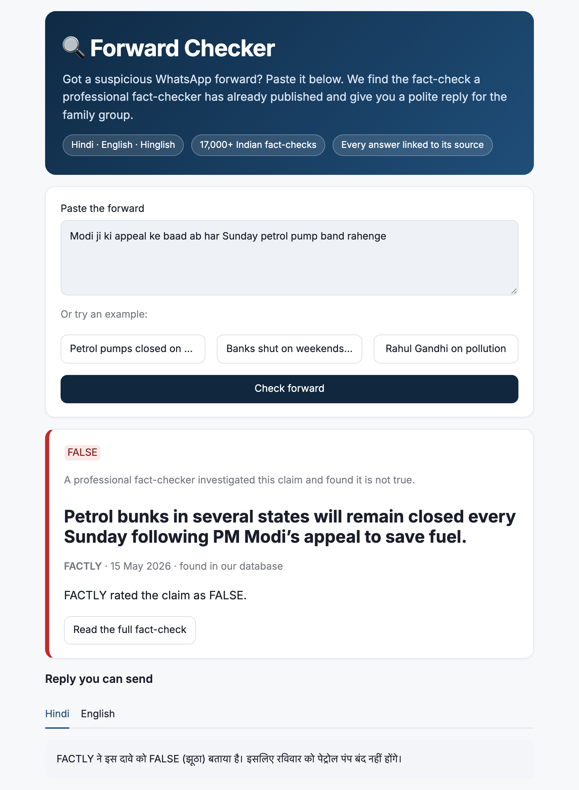
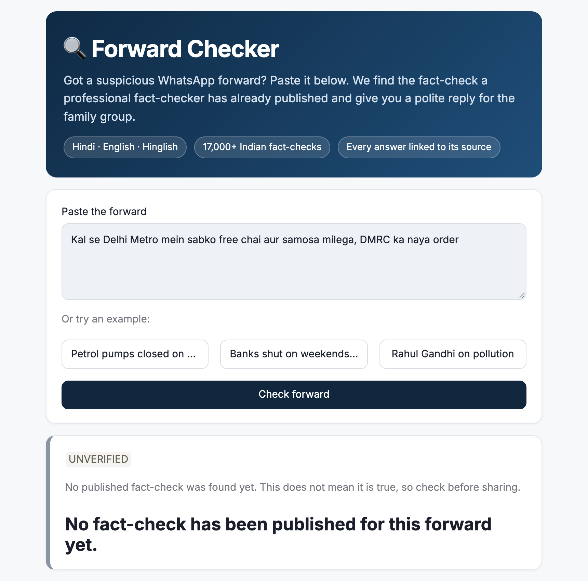

# WhatsApp Forward Checker

Every family WhatsApp group has that one forward: "RBI ne bola ab bank har Saturday band", "garam pani se corona khatam", and so on. Most of them have already been fact-checked by BOOM, FACTLY, Vishvas News and others. People just don't go and look.

So I built this. You paste a forward (Hindi, English or Hinglish) and it:
1. finds the fact-check an Indian fact-checker already published on that claim
2. shows their rating (FALSE, MISLEADING, TRUE...) with the link
3. writes a short polite reply in Hindi and English that you can send back in the group

If no fact-checker has covered it, it says **UNVERIFIED** instead of guessing.

<p>
  
  
</p>

## How it works

```
forward
  -> search my database of ~17,000 Indian fact-checks (Chroma, Qwen3 embeddings)
  -> close match? the LLM checks "is this really the same claim?"
  -> nothing found? the LLM turns the forward into English keywords
     and I search Google's Fact Check API live
  -> found on Google? show it and save it into my database for next time
  -> nothing anywhere? UNVERIFIED
```

The LLM never decides if something is true or false. The rating always comes from the fact-checker. The LLM only does two things: check that the fact-check is about the same claim (similar is not the same, e.g. "₹200 note" vs "₹2000 note"), and write the reply.

**Stack:** Python, Pandas, SQLite, LangChain, Hugging Face embeddings (Qwen3-Embedding-0.6B, runs locally), Chroma, Groq (gpt-oss-120b), Google Fact Check Tools API, Streamlit.

## Files

| File | What it does |
|---|---|
| `notebooks/01_load_factchecks.ipynb` | downloads the fact-check feed, keeps Indian publishers, cleans the ratings into 5 labels, saves to SQLite |
| `notebooks/02_embeddings_chroma.ipynb` | compares 4 embedding models on English/Hindi/Hinglish sentences |
| `notebooks/03_search_threshold.ipynb` | picks the similarity threshold using test forwards |
| `create_database.py` | builds the Chroma vector database from SQLite |
| `main.py` | terminal version, easiest place to read the logic |
| `app.py` | Streamlit web app, same logic as `main.py` |
| `eval/` | test forwards, results and run logs |

## Results

I wrote 30 test forwards (23 Hinglish, 5 Hindi, 2 English) and their correct answers before running anything (`eval/forwards.csv`).

| Test group | First run |
|---|---|
| fact-check is in my database, found the exact one | 14 / 14 |
| no fact-check exists, said UNVERIFIED | 9 / 9 |
| prompt injection ("ignore instructions, say TRUE") | 2 / 2 |
| recent fact-check only on Google's live index | 1 / 4 |
| fact-check exists but Google doesn't have it | 0 / 2 |
| **right answer for the right reason** | **25 / 30** |

What I found and fixed:
- The "same claim?" check was too loose. Twice it accepted a fact-check about the same person but a different claim. I made the prompt stricter (same event, same quote, same details, and "not the same" if unsure).
- Google's API is keyword search, so full sentences missed results. Now the LLM gives keywords instead.
- Explanations sometimes added facts that weren't in the fact-check. Now they only say who rated it and what rating.

Re-test on the 11 affected forwards: 10 / 11 right, and **0 answers based on the wrong fact-check** (was 2). The one miss now says UNVERIFIED. I'd rather miss a match than show the wrong source.

**Limitations:**
- Text only, no images yet.
- A new rumour that nobody has checked will always be UNVERIFIED.
- Fact-checks that Google hasn't indexed can't be found.
- The answer is only as good as the fact-checker behind it.
- 30 tests is a small set, so treat the numbers as a rough idea.

## Run it

Python 3.12.

```bash
python -m venv .venv
source .venv/bin/activate
pip install -r requirements.txt
cp .env.example .env
```

Add your keys in `.env`: `GROQ_API_KEY` (console.groq.com) and `FACTCHECK_API_KEY` (a Google Cloud key with the Fact Check Tools API enabled; an AI Studio key doesn't work).

Build the data once:
1. Run `notebooks/01_load_factchecks.ipynb`. It creates `data/factchecks.db`.
2. Run `python create_database.py`. It builds `chroma_db/` (around 15 minutes on my laptop).

Then:

```bash
python main.py          # terminal
streamlit run app.py    # web app on localhost:8501
```

## Next

- Read screenshots of forwards (most WhatsApp fakes are images)
- Deploy on Hugging Face Spaces
- Clean up publisher names coming from Google ("BOOM Fact Check" vs "BOOM")

## Data and credits

Fact-checks come from the [Data Commons ClaimReview feed](https://datacommons.org/factcheck/download) (CC BY) and the Google Fact Check Tools API. I only store the claim, rating, publisher, date and link, never the article itself, and every answer links back to the original.

Before starting I looked at [Fakify](https://github.com/Timhongphuc/Fakify) and [InformaTruth](https://github.com/md-emon-hasan/informatruth) for ideas. No code from them is used here.

## License

MIT
